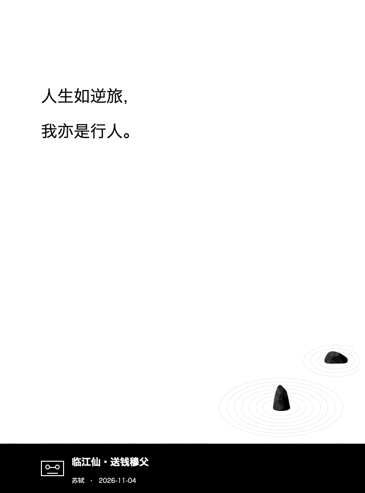

# yiyan.koplugin · 一言壁纸

为 Kindle 上的 KOReader 每天获取一句[一言](https://developer.hitokoto.cn/sentence/)，生成设备分辨率的灰度 PNG，并可自动把 KOReader 睡眠屏保切换为这张壁纸。

当前版本 **1.2.9** 使用白色背景、左上方分行正文和右下角石头与淡水波纹。左下角的圆形 CD 一半露出黑栏。书名或歌名在 CD 右侧的空间内居中，下方小字显示作者和日期。

## 安装

把整个 `yiyan.koplugin` 目录复制到：

```text
/mnt/us/koreader/plugins/yiyan.koplugin/
```

完全退出并重启 KOReader。插件启动后会延迟几秒检查当天壁纸；联网请求在后台执行，不会卡住阅读界面。

请复制整个文件夹，保留 `main.lua`、`wallpaper.lua`、`_meta.lua` 和 `assets/lyrics-background.png`。随附的背景图为 **758 × 1024**，生成时会缩放到设备的竖屏尺寸，并使用 16 级灰度抖动导出 PNG。

## 每日请求限制

- 按北京时间归档。当天收到一条有效句子后就停止自动请求，重启 KOReader 或切换图片目录也会保留成功记录。
- Wi-Fi 尚未连接时不发请求，也不会自动打开 Wi-Fi。启动、联网、唤醒和定时检查都可以触发更新。
- 断线、超时或返回无效数据时，当天可以重试。请求失败后至少等 5 分钟再试。收到 HTTP 429 时，至少等 1 小时再试。
- 建连后再次检查北京时间。跨日或距离零点不足一个请求超时时间时，推迟到后续检查。
- 自动更新优先使用当天已有的本地图片。已有归属记录时，发布前会核对图片内容。
- 返回的句子会先暂存到本地，再写入正式缓存并生成图片。暂存成功后，即使正式缓存写入或图片生成失败，也可用本地句子离线恢复。

## 句子类型

在「工具 → 一言壁纸 → 句子类型」中可以勾选一个或多个分类，支持动画、漫画、游戏、文学、原创、来自网络、其他、影视、诗词、网易云、哲学和抖机灵。选择「默认随机」可清空勾选，使用接口的默认分类。

分类设置会在下次联网请求时生效。想当天应用新的分类，可以手动重新生成壁纸。

## 自动屏保

自动配置默认开启。壁纸成功解码后，插件才备份并切换 KOReader 屏保设置。当前壁纸发布到输出目录下的 `.yiyan-screen/wallpaper.png`。如果后来在 KOReader 中手动更改了屏保模式或目录，插件会保留新设置。关闭菜单里的「自动配置 KOReader 屏保」时，仅恢复仍由插件控制的设置。

图片默认保存到：

```text
/mnt/us/koreader/screenshots/yiyan/YYYYMMDD.png
```

目录中同时保存当天的 `YYYYMMDD.json` 句子缓存和 `YYYYMMDD.attempt` 请求记录。新壁纸发布成功后，插件清理已确认归属的旧图片和缓存。用户替换过的图片及其归属记录会保留。当天更新失败时，屏保继续显示上一次壁纸。

可在「工具 → 一言壁纸 → 设置屏保图片目录」更改目录。切换时会复制可识别的今日壁纸数据。若后台任务正在运行、原目录无法读取，或新目录已有冲突的同名图片或缓存，插件会保留原目录设置。

遇到无法识别的同名缓存或图片时，插件会保留现有文件。可移走冲突文件后再生成壁纸。

## 手动操作

在「工具 → 一言壁纸」中选择「重新生成今日壁纸」，即使当天已自动更新，也可以再向一言请求一句。手动操作需要联网，遵守失败后的重试和限流等待。取得新句子并生成图片后才会切换屏保，请求失败时保留当前壁纸。

「网络诊断」显示 Wi-Fi 是否连通、今日句子和壁纸是否就绪，以及当前会话中当天最近一次请求的结果。遇到失败或限流时也会显示还需等待多久才能重试。打开诊断只读取设备和插件状态，不会额外请求一言 API。

插件通过 HTTPS 请求一言 API，并指定 UTF-8 JSON。分类使用重复的 `c` 参数，例如文学和诗词对应 `https://v1.hitokoto.cn/?encode=json&charset=utf-8&c=d&c=i`。壁纸使用返回的 `hitokoto`、`from`、`from_who` 和本地归档日期。插件负责配置 KOReader 睡眠屏保，不会修改 Kindle 原生锁屏文件。

## 卸载与彻底清理

### 卸载插件

1. 在 KOReader 的「工具 → 一言壁纸」里关闭「自动配置 KOReader 屏保」。这会恢复仍由插件控制的屏保设置。若已经删掉插件，先在 KOReader 的睡眠屏保菜单里重新选择书籍封面等模式。若继续使用随机图片，请改选其他图片目录。
2. 如果设置过自定义输出目录，先打开「设置屏保图片目录」记下路径，再完全退出 KOReader。
3. 连接 Kindle 到电脑，删除 `/mnt/us/koreader/plugins/yiyan.koplugin/`。通过 USB 打开 Kindle 时，`/mnt/us/` 对应磁盘根目录。

### 清理壁纸和缓存

- **默认目录**为 `/mnt/us/koreader/screenshots/yiyan/`。确认其中只有一言生成的文件后，可以删除整个 `yiyan/` 目录。
- **自定义目录**和以前用过的输出目录需要逐个检查。仅删除确认由一言生成的 `YYYYMMDD.png`（壁纸）、`YYYYMMDD.json`（句子缓存）、`YYYYMMDD.attempt`（请求记录）及遗留的 `.yiyan-work-*/` 临时目录。若用过旧版，也可以清理确认属于插件的同日期 `.tmp` 文件。
- 每个输出目录里的 `.yiyan-screen/` 是插件的屏保目录，通常只有 `wallpaper.png`。确认里面没有个人文件后可删除整个目录。日期相同的个人图片和 JSON 应保留。

### 清理 KOReader 设置记录（可选）

完全退出 KOReader 后，先备份 `/mnt/us/koreader/settings.reader.lua`，再用纯文本编辑器删除以下插件字段（如有）。整个设置文件需要保留。

```text
yiyan_auto_screensaver
yiyan_screensaver_backup
yiyan_save_dir
yiyan_categories
yiyan_last_attempt_date
yiyan_attempt_history
yiyan_rate_limited_until
```

若在插件管理器里停用过一言，还可删除 `plugins_disabled` 表中单独的 `yiyan` 条目。若同目录存在 `settings.reader.lua.old`，可用相同方法清理其中的一言条目，保留其余设置。

## 效果预览

下图采用相同版式参数和示例数据制作；Kindle 上的字体可能略有不同。



## 参考

KOReader 接入、后台请求和屏保设置的实现参考 [danxiangli.koplugin](https://github.com/iamzhangjinpeng/danxiangli.koplugin)。句子数据来自[一言](https://hitokoto.cn/)。

## 开发检查

离线检查使用 Python 与 `lupa` 的 Lua 5.1 运行时：

```sh
python -m unittest discover -s tests -v
```

检查覆盖分类参数、联网检查、失败后重试、每日成功去重、后台取消和超时回收、临时文件保护、离线恢复、模板升级和排版边界，不会访问一言服务。Kindle 实机显示仍需设备验证。
