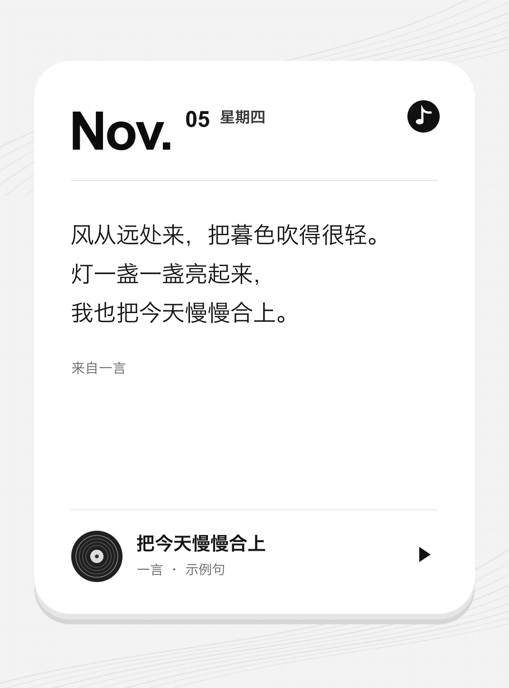
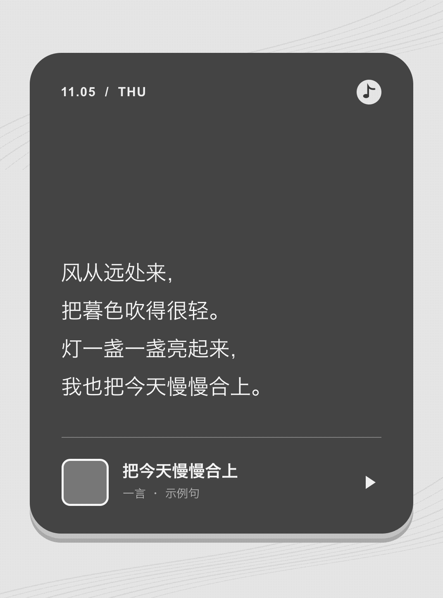

# yiyan.koplugin · 一言壁纸

为 Kindle 上的 KOReader 每天获取一句[一言](https://developer.hitokoto.cn/sentence/)，生成设备分辨率的灰度 PNG，并可自动把 KOReader 睡眠屏保切换为这张壁纸。

**v1.4.1** · [下载 Kindle 安装包](https://github.com/iamzhangjinpeng/yiyan.koplugin/releases/download/v1.4.1/yiyan.koplugin-v1.4.1-install.zip) · [更新说明](https://github.com/iamzhangjinpeng/yiyan.koplugin/releases/tag/v1.4.1)

## v1.4.1 更新内容

- 新增手动在线更新，可检查 GitHub 正式版、校验安装包并在安装失败时回滚。
- 提供原版半露 CD、白底日期卡和纯色深灰卡三种壁纸模板。
- 修复限流提示：当天已有句子时提示冷却后手动重试；首次获取失败时提示自动重试。
- 优化长句排版和屏保设置恢复，并移除 KOReader 已弃用的元数据字段。

## 主要功能

- **每日一言**。按北京时间更新，联网后在后台取句。当天成功取到一句后停止自动请求，更新失败时保留上次壁纸。
- **三种封面**。默认使用原版半露 CD，也可切换白底日期卡和纯色深灰卡。有当天缓存时可直接重绘。
- **手动换句**。可选句子分类，手动重新生成时可以联网再取一句。
- **在线更新**。从菜单检查 GitHub 正式版；确认后下载并校验安装包，替换插件文件并提示重启。不会自动联网检查。
- **屏保和诊断**。可自动配置 KOReader 睡眠屏保，也可查看网络状态、今日壁纸和重试等待时间。

## 效果预览

白底日期卡和纯色深灰卡按 Kindle Paperwhite 4 的 1072 × 1448 竖屏尺寸预览。图片使用示例句子，实机字体可能略有不同。

| 原版半露 CD（默认） | 白底日期卡 | 纯色深灰卡 |
| --- | --- | --- |
|  |  |  |

## 安装

完全退出 KOReader，解压安装包，然后把整个 `yiyan.koplugin` 文件夹复制到下列位置。已有旧版时可直接覆盖。

```text
/mnt/us/koreader/plugins/yiyan.koplugin/
```

复制完成后重启 KOReader。插件会在启动后延迟几秒检查当天壁纸，联网请求在后台执行。

请复制整个文件夹，保留 `main.lua`、`wallpaper.lua`、`updater.lua`、`_meta.lua` 和完整的 `assets/` 目录。壁纸按设备的竖屏尺寸生成，并使用 16 级灰度抖动导出 PNG。

## 菜单功能

在 KOReader 中打开「工具 → 一言壁纸」。

| 菜单项 | 功能 |
| --- | --- |
| 自动配置 KOReader 屏保 | 默认开启。壁纸就绪后，自动用它作为 KOReader 的睡眠屏保。关闭时恢复仍由插件控制的屏保设置，插件仍会生成壁纸。 |
| 句子类型（下次请求生效） | 可勾选一个或多个分类。点「默认随机」清空选择。想当天用新分类取句，可以手动重新生成今日壁纸。 |
| 封面类型 | 在「原版半露 CD（默认）」「白底日期卡」「纯色深灰卡」之间切换。有当天句子时会直接用缓存重绘。尚未取句时会保存选择，等句子就绪后使用新样式。 |
| 重新生成今日壁纸 | 联网再请求一句，即使当天已自动更新也可使用。开启自动配置时，新图生成后会替换屏保。失败时保留当前壁纸，手动请求也受重试间隔和限流等待约束。 |
| 网络诊断 | 查看 Wi-Fi 状态、今日句子和壁纸是否就绪、当前会话中当天最近一次请求结果，以及剩余重试等待时间。打开诊断不会请求一言 API。 |
| 检查在线更新 | 手动查询 GitHub 最新正式版。有新版本时可确认下载并安装；下载包会校验版本、文件清单、Lua 语法和壁纸素材。安装后可立即重启，也可稍后重启 KOReader。此功能不会自动检查更新。 |
| 设置屏保图片目录 | 查看或更改保存目录。默认是 `/mnt/us/koreader/screenshots/yiyan/`。可输入 `/mnt/us/` 下的路径，切换时会复制可识别的今日数据。 |

## 每日请求限制

- 按北京时间归档。当天收到一条有效句子后就停止自动请求，重启 KOReader 或切换图片目录也会保留成功记录。
- Wi-Fi 尚未连接时不发请求，也不会自动打开 Wi-Fi。启动、联网、唤醒和定时检查都可以触发更新。
- 断线、超时或返回无效数据时，当天可以重试。请求失败后至少等 5 分钟再试。收到 HTTP 429 时，至少等 1 小时再试。
- 建连后再次检查北京时间。跨日或距离零点不足一个请求超时时间时，推迟到后续检查。
- 自动更新优先使用当天已有的本地图片。已有归属记录时，发布前会核对图片内容。
- 返回的句子会先暂存到本地，再写入正式缓存并生成图片。暂存成功后，即使正式缓存写入或图片生成失败，也可用本地句子离线恢复。
- GitHub 在线更新只能从菜单手动启动，与每日一言请求互不影响；若网络不可用或安装包不完整，插件会保留当前版本。

## 句子类型

支持动画、漫画、游戏、文学、原创、来自网络、其他、影视、诗词、网易云、哲学和抖机灵。未选择分类时，使用接口的默认分类。

插件通过 HTTPS 请求一言 API，并指定 UTF-8 JSON。分类使用重复的 `c` 参数，例如文学和诗词对应 `https://v1.hitokoto.cn/?encode=json&charset=utf-8&c=d&c=i`。壁纸使用返回的 `hitokoto`、`from`、`from_who` 和本地归档日期。

## 自动屏保

壁纸成功解码后，插件才备份并切换 KOReader 屏保设置。当前壁纸发布到输出目录下的 `.yiyan-screen/wallpaper.png`。如果后来在 KOReader 中手动更改了屏保模式或目录，插件会保留新设置。插件只配置 KOReader 睡眠屏保。

图片默认保存到：

```text
/mnt/us/koreader/screenshots/yiyan/YYYYMMDD.png
```

目录中同时保存当天的 `YYYYMMDD.json` 句子缓存和 `YYYYMMDD.attempt` 请求记录。新壁纸发布成功后，插件清理已确认归属的旧图片和缓存。用户替换过的图片及其归属记录会保留。当天更新失败时，屏保继续显示上一次壁纸。

若后台任务正在运行、手动换句仍在等待写入原缓存、原目录无法读取，或新目录已有冲突的同名图片或缓存，插件会保留原目录设置。

遇到无法识别的同名缓存或图片时，插件会保留现有文件。可移走冲突文件后再生成壁纸。

## 卸载与彻底清理

### 卸载插件

1. 在 KOReader 的「工具 → 一言壁纸」里关闭「自动配置 KOReader 屏保」。这会恢复仍由插件控制的屏保设置。若已经删掉插件，先在 KOReader 的睡眠屏保菜单里重新选择书籍封面等模式。若继续使用随机图片，请改选其他图片目录。
2. 如果设置过自定义输出目录，先打开「设置屏保图片目录」记下路径，再完全退出 KOReader。
3. 连接 Kindle 到电脑，删除 `/mnt/us/koreader/plugins/yiyan.koplugin/`。通过 USB 打开 Kindle 时，`/mnt/us/` 对应磁盘根目录。

### 清理壁纸和缓存

- **默认目录**为 `/mnt/us/koreader/screenshots/yiyan/`。确认其中只有一言生成的文件后，可以删除整个 `yiyan/` 目录。
- **自定义目录**和以前用过的输出目录需要逐个检查。仅删除确认由一言生成的 `YYYYMMDD.png`（壁纸）、`YYYYMMDD.json`（句子缓存）、`YYYYMMDD.attempt`（请求记录）及遗留的 `.yiyan-work-*/` 临时目录。若用过旧版，也可以清理确认属于插件的同日期 `.tmp` 文件。
- 插件目录里的 `.yiyan-update-*` 是在线更新临时目录。正常更新后会自动清理；若 KOReader 提示备份保留路径，请先用其中的文件恢复，确认无需恢复后再删除。
- 每个输出目录里的 `.yiyan-screen/` 是插件的屏保目录，通常只有 `wallpaper.png`。确认里面没有个人文件后可删除整个目录。日期相同的个人图片和 JSON 应保留。

### 清理 KOReader 设置记录（可选）

完全退出 KOReader 后，先备份 `/mnt/us/koreader/settings.reader.lua`，再用纯文本编辑器删除以下插件字段（如有）。整个设置文件需要保留。

```text
yiyan_auto_screensaver
yiyan_screensaver_backup
yiyan_save_dir
yiyan_categories
yiyan_cover_style
yiyan_last_attempt_date
yiyan_attempt_history
yiyan_rate_limited_until
```

若在插件管理器里停用过一言，还可删除 `plugins_disabled` 表中单独的 `yiyan` 条目。若同目录存在 `settings.reader.lua.old`，可用相同方法清理其中的一言条目，保留其余设置。

## 参考

KOReader 接入、后台请求和屏保设置的实现参考 [danxiangli.koplugin](https://github.com/iamzhangjinpeng/danxiangli.koplugin)。句子数据来自[一言](https://hitokoto.cn/)。

## 开发检查

离线检查使用 Python 与 `lupa` 的 Lua 5.1 运行时：

```sh
python -m unittest discover -s tests -v
```

检查覆盖分类参数、联网检查、失败后重试、每日成功去重、后台取消和超时回收、临时文件保护、离线恢复、模板升级和排版边界，以及在线更新版本解析、安装包校验和替换回滚，不会访问一言或 GitHub 服务。Kindle 实机显示仍需设备验证。
